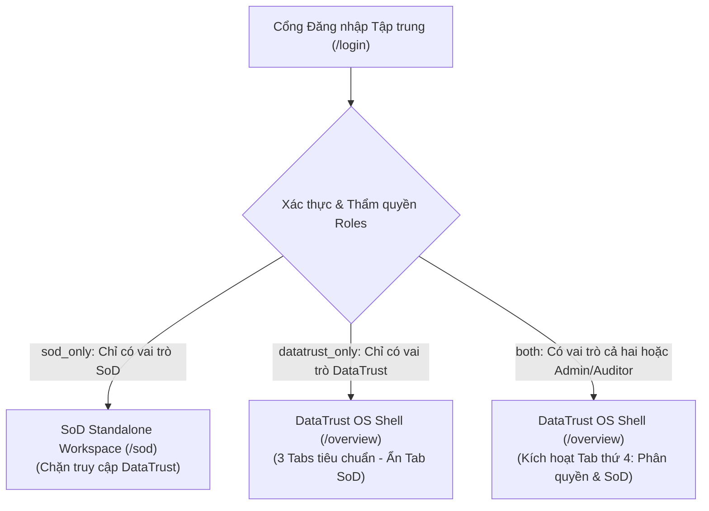

# KẾ HOẠCH TÍCH HỢP DATATRUST OS & SOD FLOW (NHÁNH `sod-production`)

Tài liệu đặc tả kiến trúc, phân kỳ triển khai và ma trận phân quyền phân tách trách nhiệm (Segregation of Duties - SoD) tích hợp giữa nền tảng **DataTrust OS** (chuẩn bị kiểm toán dữ liệu IPO) và phân hệ **SoD Flow** (phân tách trách nhiệm theo chuẩn RACIX).

---

## 1. Lộ trình Phân kỳ 3 Phase

| Phase | Tên Giai đoạn | Phạm vi Triển khai | Mục tiêu & Tiêu chí Nghiệm thu |
| :---: | :--- | :--- | :--- |
| **Phase 1** | **Unified UI & Authentication** *(Hiện tại)* | - Cổng Đăng nhập hợp nhất (Unified Login UI). - Phân nhóm 14 vai trò theo 3 nhóm quyền (`both`, `sod_only`, `datatrust_only`). - Điều hướng thông minh (Role-based Routing) & `AuthGuard`. - Tích hợp SoD thành Tab thứ 4 trong DataTrust OS cho vai trò Cả hai. - Không gian làm việc SoD Standalone cho vai trò Chỉ SoD. - Tái sử dụng trọn vẹn UI/hành vi từ nhánh `sod-production`. | Giao diện hợp nhất end-to-end, chuyển đổi mượt mà giữa các persona demo, bảo toàn nguyên vẹn dual-pane và AI Chat của DataTrust, giữ nguyên các tính năng SoD hiện có. |
| **Phase 2** | **Backend SoD & RBAC** | - Hợp nhất bảng người dùng, vai trò và phân quyền (FastAPI + PostgreSQL). - Cơ chế sinh chuỗi duyệt tuần tự RACIX (R → A → P) phía Server. - Ngăn chặn xung đột SoD tự động (DB Triggers & API Guards). - Quản trị ủy quyền có thời hạn, cấu hình ma trận 2 người (Admin ≠ CISO). - SLA chạy nền và Nhật ký kiểm toán (Audit Trail). | Backend API `/api/sod/*` thay thế hoàn toàn client preview; dữ liệu phiếu và quyết định lưu vết vĩnh viễn trong CSDL. |
| **Phase 3** | **Cross-system Integration** | - Tự động tạo phiếu SoD Approval khi DataTrust phát hiện Finding nghiêm trọng hoặc đề xuất sửa đổi Quality Rule / Quarantine. - Cơ chế Người trong vòng lặp (HITL - Human in the Loop) liên kết chặt chẽ với chuỗi phê duyệt SoD. - Ghi nhận quyết định phê duyệt vào Sổ cái bằng chứng (Evidence Ledger) với hàm băm SHA-256 Merkle DAG. - Đồng bộ trạng thái xử lý 2 chiều giữa DataTrust OS và SoD Flow. | Kiểm toán viên (Auditor) và CISO có thể truy vết xuyên suốt từ dòng dữ liệu lỗi trong DataTrust đến phiếu phê duyệt thẩm quyền trong SoD. |

---

## 2. Vai trò (Roles & Access Taxonomy)

### 2.1. Phân nhóm 3 Cấp độ Quyền hạn Truy cập Hệ thống (`SystemAccess`)
Hệ thống hỗ trợ tài khoản có một hoặc nhiều vai trò (`roles: UserRole[]`). Hàm `getSystemAccess(roles)` phân loại người dùng vào 3 cấp độ:

1. **Nhóm Cả hai Hệ thống (`both` - 4 Personas):**
   Người dùng có thẩm quyền hoạt động trên cả quy trình kiểm toán chất lượng dữ liệu của DataTrust và quy trình kiểm soát phân tách quyền SoD. Sau khi đăng nhập, hệ thống điều hướng vào `/overview` và kích hoạt Tab thứ 4 **`Phân quyền & SoD`** trên thanh điều hướng bên trái.
2. **Nhóm Chỉ SoD Flow (`sod_only` - 7 Personas):**
   Người dùng tham gia vào chuỗi yêu cầu và phê duyệt quyền truy cập nội bộ (Dev, Ops, Release, Line Manager, IAM, CISO...). Sau khi đăng nhập, hệ thống điều hướng trực tiếp vào `/sod` với giao diện SoD Standalone Workspace đầy đủ, đồng thời chặn truy cập các trang pipeline của DataTrust.
3. **Nhóm Chỉ DataTrust OS (`datatrust_only` - 3 Personas):**
   Người dùng chuyên môn về kỹ thuật dữ liệu và phân tích báo cáo (Data Steward, Analyst, Viewer). Sau khi đăng nhập, hệ thống điều hướng vào `/overview` với giao diện DataTrust OS tiêu chuẩn (3 tabs), không hiển thị và chặn truy cập vào phân hệ SoD.

---

### 2.2. Bảng Ma trận 14 Vai trò Chi tiết

| STT | Mã Vai trò | Tên Persona Mẫu | Username Mẫu | Nhóm Quyền | Trang đích sau Login | Quyền hạn DataTrust | Quyền hạn SoD Flow |
| :---: | :--- | :--- | :--- | :---: | :---: | :--- | :--- |
| **I** | **NHÓM CẢ HAI HỆ THỐNG (BOTH)** | | | | | | |
| 1 | `ADMIN` | Nguyễn Quốc Bảo | `admin` / `bao.nq` | `both` | `/overview` (+ Tab SoD) | Toàn quyền quản trị hệ thống, quản lý dataset, triggers, pipeline runs. | Đề xuất cập nhật cấu hình ma trận SoD (Maker); Quản trị người dùng & vai trò. |
| 2 | `AUDITOR` | Trần Minh Hoàng | `auditor` / `hoang.tran` | `both` | `/overview` (+ Tab SoD) | Thẩm tra độc lập, kích hoạt Audit Run, kiểm tra Sổ cái Merkle SHA-256 Ledger. | Rà soát kiểm soát trước thực thi (R) trong SoD; Xuất Báo cáo bằng chứng kiểm toán. |
| 3 | `DPO` | Lê Chi | `dpo` / `chi.le` | `both` | `/overview` (+ Tab SoD) | Duyệt Maker-Checker cấp cao các đề xuất PII (GDPR Art 6, Nghị định 13/2023). | Phê duyệt yêu cầu cấp quyền có dữ liệu PII và ngoại lệ bảo mật SoD. |
| 4 | `SO` | Hồ Sơn | `so` / `son.ho` | `both` | `/overview` (+ Tab SoD) | Xác nhận nghiệp vụ quy tắc dữ liệu, xem xét ảnh hưởng tới ứng dụng. | Phê duyệt quyền truy cập ứng dụng và database nghiệp vụ do mình làm chủ quản. |
| **II** | **NHÓM CHỈ SOD FLOW (SOD ONLY)** | | | | | | |
| 5 | `REQ` | Nguyễn An | `an.nguyen` | `sod_only` | `/sod` (Standalone) | *Không có quyền truy cập* | Khởi tạo phiếu xin cấp quyền, thay đổi vai trò hoặc phiếu ngoại lệ kiểm soát. |
| 6 | `LM` | Trần Bình | `binh.tran` | `sod_only` | `/sod` (Standalone) | *Không có quyền truy cập* | Phê duyệt bước 1: Xác nhận nhu cầu công việc của nhân viên cấp dưới trực tiếp. |
| 7 | `IAM` | Vũ Hà | `ha.vu` | `sod_only` | `/sod` (Standalone) | *Không có quyền truy cập* | Thực thi cấp/thu hồi tài khoản trên IAM/PAM sau khi phiếu có đủ chữ ký duyệt. |
| 8 | `DEV` | Đỗ Khoa | `khoa.do` | `sod_only` | `/sod` (Standalone) | *Không có quyền truy cập* | Yêu cầu thay đổi mã nguồn; Bị chặn quyền tự duyệt phát hành hoặc deploy Prod. |
| 9 | `REL` | Bùi Lan | `lan.bui` | `sod_only` | `/sod` (Standalone) | *Không có quyền truy cập* | Kiểm tra biên bản test UAT; Phê duyệt phát hành phiên bản lên Production. |
| 10 | `OPS` | Ngô Minh | `minh.ngo` | `sod_only` | `/sod` (Standalone) | *Không có quyền truy cập* | Triển khai hạ tầng và release Prod sau khi đã có phê duyệt của Release Manager. |
| 11 | `CISO` | Hoàng Giang | `giang.hoang` | `sod_only` | `/sod` (Standalone) | *Không có quyền truy cập* | Phê duyệt cấu hình ma trận SoD do Admin đề xuất (Checker); Duyệt ngoại lệ Level 3. |
| **III** | **NHÓM CHỈ DATATRUST OS (DATATRUST ONLY)** | | | | | | |
| 12 | `DATA_STEWARD` | Lê Nam | `steward.le` | `datatrust_only` | `/overview` | Duyệt Quality Rules; Duyệt đề xuất khắc phục vi phạm (Remediation); Xử lý Quarantine. | *Không có quyền truy cập* |
| 13 | `ANALYST` | Vũ Mai | `analyst.vu` | `datatrust_only` | `/overview` | Khảo sát dữ liệu, phân tích nguyên nhân gốc rễ (RCA) của Finding, đề xuất quy tắc. | *Không có quyền truy cập* |
| 14 | `VIEWER` | Trần Đức | `viewer.tran` | `datatrust_only` | `/overview` | Xem dashboard tổng quan, chỉ số KPI tuân thủ, biểu đồ chất lượng (Read-only). | *Không có quyền truy cập* |

---

### 2.3. Quy tắc Phân tách Trách nhiệm Bắt buộc (SoD Constraints)
Hệ thống SoD Flow áp dụng các ràng buộc cấm kết hợp quyền bất khả xâm phạm:
1. **Chống Tự duyệt (No Self-Approval):** Người khởi tạo (`Requestor`) không bao giờ được phép phê duyệt (`Approver`) yêu cầu của chính mình ở bất kỳ bước nào trong chuỗi.
2. **Tách biệt Phát triển và Triển khai (`DEV ↔ REL / OPS`):** Lập trình viên trực tiếp phát triển mã nguồn không được quyền phê duyệt phát hành (`Release Manager`) hoặc trực tiếp triển khai lên Production (`Production Operator`).
3. **Tách biệt Quản trị Định danh và Phê duyệt (`Approver ↔ IAM`):** Người phê duyệt cấp quyền không được kiêm quyền thực thi tài khoản trên hệ thống IAM/PAM.
4. **Nguyên tắc Hai Người cho Cấu hình Hệ thống (2-Person Rule: `ADMIN ≠ CISO`):** Quản trị viên (`ADMIN`) chỉ có quyền tạo đề xuất cấu hình ma trận phiên bản mới; người quyết định kích hoạt áp dụng bắt buộc phải là Giám đốc An toàn Thông tin (`CISO`).
5. **Kiểm tra Trước Thực thi của Kiểm toán viên (`Auditor R`):** Bước rà soát của Kiểm toán viên độc lập luôn chen ngay trước bước thực thi kỹ thuật (`P`) để bảo đảm bằng chứng trước khi thay đổi được ghi nhận.

---

## 3. Kiến trúc Giao diện & Điều hướng Phase 1

### 3.1. Phân biệt Xác thực Demo và Xác thực Production
- **Demo Authentication (Phase 1):**
  - Cổng đăng nhập `/login` cung cấp bảng **Quick Persona Switcher** với 14 tài khoản mẫu.
  - Khi click vào bất kỳ persona nào, hệ thống nạp trạng thái phiên làm việc vào `localStorage` (`datatrust_demo_session`).
  - Giao diện có nhãn nhận diện rõ ràng **`Demo Mode`**.
  - Khi chuyển đổi giữa các persona, toàn bộ state phiên cũ (draft form, filter, tab đang chọn) sẽ được làm sạch triệt để (`resetSessionState`).
- **Production Authentication (Phase 2):**
  - Được thực hiện qua backend API bảo mật với JWT / Session Cookie ký chữ ký số HMAC-SHA256 hoặc kết nối LDAP/SSO doanh nghiệp.
  - Phân quyền thực tế được kiểm chứng tại từng endpoint của FastAPI.

### 3.2. Không gian làm việc SoD Workspace Wrapper
Thay vì viết lại giao diện SoD, hệ thống xây dựng component [`SodWorkspace`](file:///E:/Phase2_VSF/frontend/src/components/sod/SodWorkspace.tsx) bao bọc (wrapper) và tái sử dụng trực tiếp các thành phần giao diện thực tế từ `sod-production`:
- **Chế độ Embedded:** Nhúng vào `AppShell` của DataTrust OS thành Tab thứ 4 (`/sod`) dành cho các vai trò `ADMIN`, `AUDITOR`, `DPO`, `SO`.
- **Chế độ Standalone:** Hiển thị toàn màn hình với thanh điều hướng và topbar riêng của SoD Flow dành cho các vai trò `sod_only`.
- Các màn hình SoD tái sử dụng:
  * **Ma trận RACIX:** Hiển thị 19 hoạt động kiểm soát ITGC với bộ ký hiệu `P, A, R, C, I, X` chuẩn.
  * **Phiếu yêu cầu:** Danh sách phiếu với trạng thái thực tế (`OPEN`, `RETURNED`, `DONE`, `REJECTED`, `CANCELLED`).
  * **Tạo phiếu mới:** Form nhập yêu cầu và bộ xem trước chuỗi duyệt tuần tự theo thời gian thực (Live Preview RACIX Chain).
  * **Hộp việc cần xử lý:** Danh sách công việc đang chờ persona hiện tại phê duyệt, kèm thanh tiến độ SLA đếm ngược.
  * **Ủy quyền vắng mặt:** Thiết lập chuyển giao quyền hạn cùng vai trò trong một khoảng thời gian nhất định.
  * **Quản trị cấu hình:** Bảng đề xuất thay đổi ô ma trận tuân thủ nguyên tắc 2 người (`ADMIN` đề xuất, `CISO` phê duyệt).
  * **Bằng chứng kiểm toán:** Báo cáo bằng chứng độc lập cho Kiểm toán viên kèm hàm băm SHA-256.
