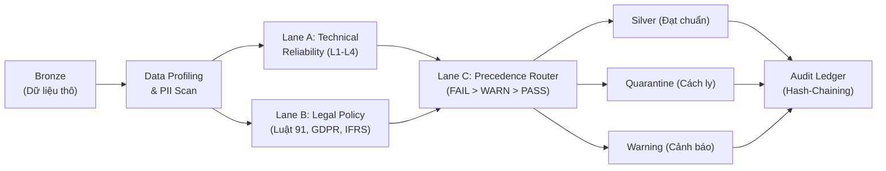
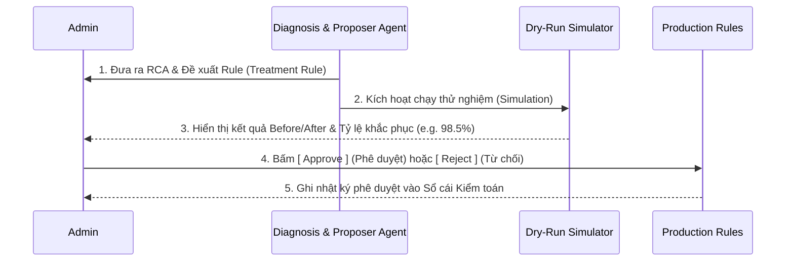
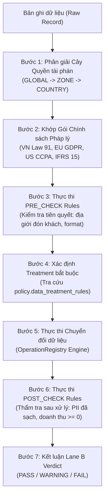

# CẨM NANG HƯỚNG DẪN SỬ DỤNG HỆ THỐNG DATATRUST OS (DÀNH CHO ADMIN)

> **Hệ thống:** DataTrust OS — Phase 2 VSF (VinFast / GSM Global 3-Zone Pilot: VN, EU, US)  
> **Phiên bản tài liệu:** 2.1 (Cập nhật tháng 10/2026)  
> **Tiêu chuẩn tuân thủ:** Luật 91/2025/QH15 & Nghị định 356/2025/NĐ-CP (Bảo vệ dữ liệu cá nhân), EU GDPR, US CCPA/CPRA, IFRS 15 / SOX 404, ISO 8000, ISO 26262 ASIL-D & UN ECE R100.

---

## MỤC LỤC
1. [Giới thiệu & Kiến trúc Tổng thể](#1-giới-thiệu--kiến-trúc-tổng-thể)
2. [Phân quyền & Vai trò Admin](#2-phân-quyền--vai-trò-admin)
3. [Giao diện Làm việc Dual-Pane & Phím tắt](#3-giao-diện-làm-việc-dual-pane--phím-tắt)
4. [Quản lý Bộ dữ liệu & Khởi chạy Pipeline](#4-quản-lý-bộ-dữ-liệu--khởi-chạy-pipeline)
5. [Giám sát & Đọc Kết quả Kiểm toán 3 Làn](#5-giám-sát--đọc-kết-quả-kiểm-toán-3-làn)
6. [Quản lý Vi phạm (Findings) & Phê duyệt HITL Remediation](#6-quản-lý-vi-phạm-findings--phê-duyệt-hitl-remediation)
7. [Truy vết Phả hệ Dữ liệu (Data Lineage & Schema Diff)](#7-truy-vết-phả-hệ-dữ-liệu-data-lineage--schema-diff)
8. [Cơ chế Xử lý Dữ liệu (Treatment) & Kiểm tra Tuân thủ (Compliance Check)](#8-cơ-chế-xử-lý-dữ-liệu-treatment--kiểm-tra-tuân-thủ-compliance-check)
9. [Sổ cái Bằng chứng Bất biến (IPO Assurance Ledger)](#9-sổ-cái-bằng-chứng-bất-biến-ipo-assurance-ledger)
10. [Khai thác Trợ lý AI Companion](#10-khai-thác-trợ-lý-ai-companion)
11. [Vận hành Kỹ thuật & Khắc phục Sự cố (Troubleshooting)](#11-vận-hành-kỹ-thuật--khắc-phục-sự-cố-troubleshooting)

---

## 1. Giới thiệu & Kiến trúc Tổng thể

**DataTrust OS** là nền tảng quản trị và kiểm soát chất lượng dữ liệu doanh nghiệp tự động hóa, được thiết kế chuyên biệt phục vụ tiêu chuẩn kiểm toán IPO quốc tế. Hệ thống vận hành theo quy trình khép kín:



### Nguyên tắc Phân luồng Định tuyến (Lane C Matrix):
1. **Silver (`silver.*`)**: Bản ghi đạt toàn bộ kiểm tra vật lý (Lane A) và chính sách (Lane B). Đã qua xử lý che giấu thông tin định danh (PII Treatment) an toàn để đưa vào hồ sơ thương mại/kế toán.
2. **Quarantine (`quarantine.records`)**: Bản ghi vi phạm nghiêm trọng (lỗi kỹ thuật xe hoặc chặn chính sách pháp lý). Bản ghi gốc 100% được lưu trữ cách ly để điều tra nguyên nhân (RCA) mà không gây bẩn dữ liệu sạch.
3. **Warning (`warning.records`)**: Bản ghi có độ lệch thống kê nhẹ (L2-L4 drift) hoặc cảnh báo khuyến nghị. Dữ liệu được thông qua kèm gắn cờ kiểm toán và tự động che giấu PII.

---

## 2. Phân quyền & Vai trò Admin

Hệ thống hỗ trợ chuyển đổi vai trò linh hoạt tại thanh Topbar:

| Quyền hạn | Quản trị viên (Admin)<br/>*Nguyễn Quốc Bảo* | Kiểm toán viên (Auditor)<br/>*Trần Minh Hoàng* |
| :--- | :---: | :---: |
| Kích hoạt Pipeline kiểm toán (`Start Run`) | ✅ | ✅ (Thẩm tra độc lập) |
| Xem Báo cáo kiểm toán, Lineage, Evidence | ✅ | ✅ |
| Truy cập Sổ cái băm SHA-256 | ✅ | ✅ |
| **Phê duyệt đề xuất xử lý dữ liệu (HITL Remediation)** | ✅ | ❌ (Chỉ xem) |
| **Bật/Tắt, Chỉnh sửa Biểu thức Quy tắc (Rules)** | ✅ | ❌ (Chỉ xem) |
| **Xử lý bản ghi cách ly (Release/Quarantine Override)** | ✅ | ❌ |
| Cấu hình tích hợp hệ thống & API Keys | ✅ | ❌ |

> [!IMPORTANT]
> **Ranh giới trách nhiệm**: Mọi quyết định phê duyệt (HITL) của Admin đều được ghi nhật ký bất biến vào Sổ cái Kiểm toán kèm Timestamp và User ID phục vụ hậu kiểm.

---

## 3. Giao diện Làm việc Dual-Pane & Phím tắt

Hệ thống áp dụng kiến trúc giao diện **Dual-Pane toàn cục (Dual-Pane Global Shell)**:

```
+-----------------------------------------------------------------------------------------+
| [⚡ DataTrust OS]     [Dataset: ride_hailing]     [Run: run_5b98...]      [Role: Admin] |
+-----+---------------------------------------------------+-------------------------------+
|     |                                                   |                               |
| R   |            AI CHAT COMPANION                      |       DYNAMIC WORKSPACE       |
| A   |            (Persistent Panel)                     |       (Khu vực làm việc)      |
| I   |                                                   |                               |
| L   | - Tự động bám sát Run hiện tại                   | - Tổng quan (/overview)       |
|     | - Chẩn đoán RCA & Đề xuất Rule                    | - Lần chạy & Lineage (/runs)  |
| 68px| - Giải thích 200 Warning                          | - Quy tắc & Luật (/rules)     |
|     |                                                   |                               |
+-----+---------------------------------------------------+-------------------------------+
```

* **Slim Icon Rail (68px bên trái cùng)**:
  * 🏠 `Trang chủ (/overview)`: Khám phá Dataset và khởi động kiểm toán nhanh.
  * ⚡ `Lần chạy (/runs)`: Giám sát pipeline, xem kết quả, quản lý Findings và Data Lineage.
  * ⚖️ `Quy tắc (/rules)`: Tra cứu danh mục quy chuẩn Lane A và Lane B.
* **AI Chat Companion (380px - 430px)**: Luôn hiển thị cố định, không bị tải lại (re-mount) khi đổi trang, duy trì trạng thái ngữ cảnh hội thoại.
* **Phím tắt hữu ích**:
  * `Alt + [`: Ẩn/Hiện nhanh bảng AI Chat Companion.
  * `Esc`: Đóng các Drawer trượt và Modal.

---

## 4. Quản lý Bộ dữ liệu & Khởi chạy Pipeline

### 4.1. Danh mục 8 Bộ dữ liệu Chuẩn (PostgreSQL Bronze)
1. `ride_hailing_xanh_sm_trips`: Cuốc xe taxi điện, cước phí, tọa độ GPS.
2. `synthetic_ev_telemetry_ved_ref`: Dữ liệu telemetry pin, tốc độ, điện áp, nhiệt độ xe.
3. `acn_charging_mapped`: Phiên sạc pin xe điện, công suất sạc trụ sạc.
4. `dim_customers`: Hồ sơ khách hàng, số điện thoại, CCCD.
5. `dim_drivers`: Thông tin tài xế, mã định danh, bằng lái.
6. `synthetic_feedback_scenario_driven`: Đánh giá phản hồi dịch vụ khách hàng.
7. `generic_clean_records`: Bản ghi tích hợp chuẩn hóa chung.
8. `operational_audit_logs`: Nhật ký vận hành hệ thống.

### 4.2. Khởi chạy Pipeline Kiểm toán
1. Tại Trang chủ (`/overview`) hoặc Lần chạy (`/runs`), bấm nút **`[Chạy kiểm tra]`** hoặc **`[Chạy mới]`**.
2. **Start Run Modal** xuất hiện:
   * Chọn Dataset mục tiêu (hoặc chạy toàn bộ).
   * Hệ thống **mặc định 100% tự động thu thập Bằng chứng kiểm toán** và **phát sinh Data Lineage** (không cho phép tắt để bảo toàn tính toàn vẹn IPO).
3. Bấm **`Bắt đầu chạy`**: Hệ thống tạo một mã lần chạy duy nhất (ví dụ: `run_5b98f3ad9d0d`) và kích hoạt Airflow DAG thực thi song song.

---

## 5. Giám sát & Đọc Kết quả Kiểm toán 3 Làn

Khi lượt chạy hoàn tất, màn hình Workspace Lần chạy (`/runs/:id`) cung cấp các thông tin trọng yếu:

### 5.1. Bảng Chỉ số Thực thi (Pipeline KPIs)
* **Tổng quét (Scanned Count)**: Số lượng bản ghi thô đầu vào được kiểm tra.
* **Silver (Đạt chuẩn)**: Tỷ lệ bản ghi hợp lệ sẵn sàng chuyển tiếp sang kho dữ liệu sản xuất.
* **Quarantine (Cách ly)**: Bản ghi có lỗi chặn. Cần Admin kiểm tra trong danh sách Findings.
* **Warning (Cảnh báo)**: Bản ghi có độ lệch nhẹ. Không chặn luồng nhưng cần theo dõi xu hướng.
* **Chưa đánh giá (Not Evaluated)**: Số bản ghi chưa xử lý xong (thường bằng 0 khi pipeline chạy thành công).

### 5.2. Công thức Đối soát Toàn vẹn (Reconciliation Balance)
Admin cần kiểm tra nguyên tắc cân bằng số liệu:
$$\text{Scanned} = \text{Silver} + \text{Quarantine} + \text{Warning} + \text{Not Evaluated}$$

---

## 6. Quản lý Vi phạm (Findings) & Phê duyệt HITL Remediation

### 6.1. Chi tiết Lỗi kiểm toán (Finding Detail)
Khi một bản ghi bị đưa vào Quarantine, hệ thống tự động sinh một mã Finding tương ứng (ví dụ: `FND-7cb4e4fa6e`):
* **Column Name**: Cột phát sinh lỗi (ví dụ: `pickup_latitude`).
* **Failure Lane**: `LANE_A` (Lỗi kỹ thuật xe), `LANE_B` (Lỗi chính sách pháp lý), hoặc `BOTH`.
* **Reason & Law Ref**: Diễn giải vi phạm và căn cứ luật (ví dụ: *Vượt quá độ chính xác tọa độ cho phép theo Nghị định 356/2025/NĐ-CP*).

### 6.2. Quy trình Phê duyệt Human-in-the-Loop (HITL)
Admin là người giữ quyền quyết định cao nhất đối với các đề xuất sửa chữa dữ liệu:



1. **Xem xét Before/After**: Kiểm tra bảng so sánh dữ liệu trước và sau khi áp dụng thuật toán làm sạch.
2. **Kiểm tra Side-effects**: Xem tỷ lệ rủi ro phát sinh lỗi phụ.
3. **Thao tác phê duyệt**:
   * **Approve**: Phê duyệt quy tắc để hệ thống đưa vào bộ luật xử lý tự động cho các lần chạy sau.
   * **Modify**: Điều chỉnh tham số (ngưỡng ngưỡng, độ lệch chuẩn, số chữ số làm tròn).
   * **Reject**: Bác bỏ đề xuất và giữ nguyên cách ly bản ghi.

---

## 7. Truy vết Phả hệ Dữ liệu (Data Lineage & Schema Diff)

Tính năng Data Lineage tại tab **Phả hệ dữ liệu** cho phép truy nguyên nguồn gốc từng trường dữ liệu mà không phụ thuộc vào công cụ bên ngoài:

### 7.1. Đồ thị Phả hệ (Interactive Graph)
* **Các tầng dữ liệu**: `RAW` $\to$ `BRONZE` $\to$ `SILVER` / `QUARANTINE` / `WARNING`.
* **Màu sắc trạng thái**:
  * 🟢 **Xanh lục (Silver)**: Dữ liệu sạch, sẵn sàng kinh doanh.
  * 🔴 **Đỏ hồng (Quarantine)**: Nhánh rẽ cô lập dữ liệu lỗi.
  * 🟡 **Vàng (Warning)**: Nhánh rẽ dữ liệu cảnh báo.
  * 🔵 **Xanh lam (Upstream/Downstream)**: Khi bấm chọn một nút, các nút liên đới nguồn và đích sẽ tự động phát sáng.

### 7.2. So sánh Cấu trúc (Schema Diff)
Cho phép Admin đối chiếu sự biến đổi cấu trúc giữa Bronze và Silver:
* Cột bị che mờ (Masked): Số điện thoại, email.
* Cột bị băm (Hashed): Định danh khách hàng, tài xế.
* Cột làm tròn (Generalized): Tọa độ vĩ độ/kinh độ từ 6 số thập phân về 2 số thập phân.

### 7.3. Xuất Metadata Chuẩn OpenLineage 1.0
Bấm nút **`[OpenLineage 1.0]`** trên thanh công cụ để tải xuống tệp JSON đặc tả toàn bộ đồ thị phả hệ, phục vụ nộp cho các tổ chức kiểm toán quốc tế.

---

## 8. Cơ chế Xử lý Dữ liệu (Treatment) & Kiểm tra Tuân thủ (Compliance Check)

Hệ thống DataTrust OS quản trị chất lượng dữ liệu thông qua hai cơ chế bổ trợ lẫn nhau tại **Task 3**:
1. **Lane A**: Bộ kiểm soát độ tin cậy kỹ thuật & vật lý (L1 Deterministic, L2 Statistical Outliers, L3 Multivariate Regression, L4 Change Point Detection).
2. **Lane B**: Bộ xử lý chính sách tuân thủ thứ bậc đa quyền tài phán (Hierarchical Policy Processor & OperationRegistry).

---

### 8.1. Quy trình Kiểm tra Tuân thủ Lane B (7 Bước Khép kín)

Khi một bản ghi đi vào Lane B, hệ thống thực hiện tuần tự 7 bước:



#### Phân biệt ranh giới PRE_CHECK và POST_CHECK:
* **PRE_CHECK (`evaluation_phase = 'PRE_CHECK'`)**:
  - Diễn ra **trước khi** dữ liệu được can thiệp hay che giấu.
  - Mục đích: Phát hiện các vi phạm về tính hợp lệ căn bản, nghiệp vụ kinh doanh hoặc điều kiện đón/trả khách trước khi xử lý (ví dụ: cấm cuốc xe ngoài địa giới đăng ký, kiểm tra tài xế có trạng thái hoạt động).
* **POST_CHECK (`evaluation_phase = 'POST_CHECK'`)**:
  - Diễn ra **sau khi** các hàm trong `OperationRegistry` đã chuyển đổi dữ liệu.
  - Mục đích: Nghiệm thu kết quả xử lý bảo vệ dữ liệu (ví dụ: đảm bảo trường `customer_contact` không còn chuỗi 10 số liên tục, tọa độ GPS đã làm tròn $\le 2$ số thập phân, doanh thu sau khấu trừ cước không âm theo chuẩn IFRS 15).

---

### 8.2. Danh mục Hàm Xử lý Dữ liệu (`OperationRegistry`)

Hệ thống sử dụng module dùng chung [`OperationRegistry`](file:///E:/Phase2_VSF/backend/engine/operation_registry.py), hoạt động độc lập và không bị hardcode vào bất kỳ bảng hay cột cụ thể nào:

| Operation ID | Tên chức năng | Mô tả hoạt động | Tham số cấu hình (`params_json`) | Ví dụ Đầu vào $\to$ Đầu ra |
| :--- | :--- | :--- | :--- | :--- |
| `MASK` / `MASK_PHONE` | Che mờ ký tự | Giữ lại $N$ ký tự đầu và $M$ ký tự cuối, thay phần giữa bằng ký tự che mờ. | `{"prefix_len": 3, "suffix_len": 2, "mask_char": "*"}` | `"0987654321"` $\to$ `"098*****21"` |
| `MASK_EMAIL` | Che mờ hòm thư | Giữ lại ký tự đầu tiên của tên người dùng, che phần còn lại, giữ nguyên tên miền domain. | `{"mask_char": "*", "keep_domain": true}` | `"nguyen.van.a@gmail.com"` $\to$ `"n***@gmail.com"` |
| `MASK_CONTACT` | Che mờ liên hệ động | Tự động nhận diện Email (chứa `@`) hoặc Số điện thoại để áp dụng phương pháp che mờ thích hợp. | `{"prefix_len": 3, "suffix_len": 2, "keep_domain": true}` | Áp dụng linh hoạt cho cột đa năng `customer_contact`. |
| `MASK_NAME` | Che mờ họ tên | Tách các từ trong họ tên, giữ ký tự đầu của mỗi từ và thay các ký tự sau bằng `*`. | `{"mask_char": "*", "keep_initials": true}` | `"Nguyễn Văn An"` $\to$ `"N***** V** A*"` |
| `HASH` / `HASH_SHA256` | Băm 1 chiều có Salt | Áp dụng hàm băm SHA-256 kết hợp mã muối bảo mật (Salt) từ biến môi trường. Không thể giải mã ngược. | `{"algorithm": "sha256", "salt_ref": "gsm_driver_salt_2026"}` | `"DRV_09812"` $\to$ `"e3b0c44298fc1c149afbf4c8996fb92427ae41e4649b934ca495991b7852b855"` |
| `HMAC_SHA256` | Băm xác thực có Khóa | Băm bảo mật có khóa mật mã bí mật để xác thực tính toàn vẹn bản ghi. | `{"secret_ref": "DATATRUST_HMAC_SECRET"}` | Chuỗi định danh thiết bị IoT hoặc Token định danh. |
| `ROUND` / `ROUND_DECIMAL` | Làm tròn số thực | Làm tròn số thập phân (đặc biệt áp dụng cho vĩ độ/kinh độ GPS để ẩn danh hóa vị trí cư dân). | `{"decimals": 2}` | `21.028511` $\to$ `21.03` *(Độ chính xác tương đương ~1.1 km)* |
| `GENERALIZE` / `BUCKETIZE` | Tổng quát hóa dải số | Gom nhóm giá trị số thành khoảng dải (k-anonymity) để chống định danh chéo. | `{"level": 10, "method": "bucket"}` | Tuổi `27` $\to$ `"20-29"` |
| `REMOVE` / `REDACT` | Loại bỏ trường | Xóa bỏ hoàn toàn giá trị của trường (trả về `null`). | `{}` | Trường mật mã, token nội bộ $\to$ `null` |
| `REDACT_PII_TEXT` | Che mờ Regex trong văn bản | Quét biểu thức chính quy (Regex) và thay thế số điện thoại, email trong văn bản tự do. | `{"replacement": "[REDACTED]"}` | `"Gặp khách tại 0987654321 gấp"` $\to$ `"Gặp khách tại [REDACTED] gấp"` |

---

### 8.3. Hướng dẫn Thêm Policy & Quy tắc Mới dành cho Admin

Khi doanh nghiệp mở rộng thị trường hoặc pháp luật ban hành quy định mới (ví dụ bổ sung Nghị định mới về xe tự hành), Admin thực hiện theo quy trình sau:

#### Bước 1: Khai báo Quy tắc Xử lý Dữ liệu (`policy.data_treatment_rules`)
Admin khai báo quy tắc chuyển đổi dữ liệu cần áp dụng cho cột mục tiêu:

```sql
INSERT INTO policy.data_treatment_rules (
    rule_id,
    dataset_id,
    column_name,
    operation_id,
    treatment_name,
    params_json,
    expression_display,
    description,
    policy_id,
    policy_name,
    law_ref,
    jurisdiction,
    country,
    status,
    enforced_by
) VALUES (
    'TRT-VN-PHONE-MASK',
    'ride_hailing_xanh_sm_trips',
    'customer_contact',
    'MASK',
    'Che mờ số điện thoại khách hàng (3 đầu, 2 đuôi)',
    '{"prefix_len": 3, "suffix_len": 2, "mask_char": "*"}'::jsonb,
    'MASK(customer_contact, prefix=3, suffix=2)',
    'Tuân thủ bảo vệ số thuê bao cá nhân theo Luật 91/2025/QH15',
    'POL-VN-LAW91',
    'Vietnam Personal Data Protection',
    'Luật 91/2025/QH15 Điều 17',
    'VN',
    'VNM',
    'active',
    'Admin'
);
```

#### Bước 2: Khai báo Quy tắc Thẩm tra Tuân thủ (`policy.compliance_rules`)
Admin định nghĩa điều kiện kiểm tra (Assertion) để hệ thống đánh giá tính hợp lệ:

```sql
INSERT INTO policy.compliance_rules (
    rule_id,
    version,
    dataset_id,
    column_name,
    rule_name,
    rule_code,
    expression,
    description,
    policy_id,
    policy_name,
    law_ref,
    jurisdiction,
    country,
    rule_domain,
    severity,
    on_fail_action,
    status,
    evaluation_phase,
    legal_review_required,
    runtime_mode
) VALUES (
    'COMP-VN-GPS-PRECISION-01',
    1,
    'ride_hailing_xanh_sm_trips',
    'pickup_latitude',
    'Giới hạn độ chính xác GPS đón khách tối đa 2 chữ số thập phân',
    'GPS_PRECISION_LIMIT',
    'ROUND(pickup_latitude, 2) == pickup_latitude',
    'Ngăn chặn theo dõi vị trí chính xác của công dân ngoài phạm vi vận hành',
    'POL-VN-LAW91',
    'Vietnam Personal Data Protection',
    'Nghị định 356/2025/NĐ-CP Điều 22',
    'VN',
    'VNM',
    'LANE_B',
    'HIGH',
    'QUARANTINE',
    'ACTIVE',
    'POST_CHECK',
    FALSE,
    'ENFORCED'
);
```

> [!TIP]
> **Chế độ Chạy Thử nghiệm (Shadow Mode)**:
> Khi thử nghiệm luật mới chưa chắc chắn về tác động nghiệp vụ, hãy đặt `runtime_mode = 'SHADOW'`. Ở chế độ này, vi phạm vẫn được ghi nhận vào nhật ký kiểm toán nhưng hệ thống **không chặn hay cách ly bản ghi vào Quarantine**, giúp Admin đo lường tỷ lệ ảnh hưởng thực tế trước khi chuyển sang `ENFORCED`.

#### Bước 3: Cổng Phê duyệt Pháp chế (Legal Review Gate)
Đối với các quy tắc trọng yếu có đánh dấu `legal_review_required = TRUE`:
* Trạng thái mặc định khi thêm mới là `PENDING_APPROVAL`.
* Quy tắc **không thể kích hoạt (`ACTIVE`)** nếu chưa có chữ ký số của Chuyên viên Pháp chế (`LEGAL`) hoặc Cán bộ Bảo vệ Dữ liệu (`DPO`):

```sql
UPDATE policy.compliance_rules
SET 
    status = 'ACTIVE',
    approved_by = 'tran.thi.b@vinfast.vn',
    approved_at = CURRENT_TIMESTAMP,
    approval_role = 'DPO'
WHERE rule_id = 'COMP-VN-GPS-PRECISION-01' AND version = 1;
```

#### Bước 4: Thêm Quy tắc Tự động qua Đề xuất AI (HITL AI Proposal)
Nếu Admin không muốn viết SQL thủ công:
1. Khi AI Agent phân tích một Finding và phát hiện giải pháp khả thi, nó sẽ sinh ra một đề xuất tại màn hình Finding Detail.
2. Đề xuất đi kèm kết quả **Dry-run Simulation** (cho biết tỷ lệ khắc phục thành công và rủi ro phát sinh).
3. Admin chỉ cần nhấn **`[ Approve Treatment ]`**, hệ thống sẽ tự động thêm quy tắc vào bảng `policy.data_treatment_rules` với `is_ai_proposed = TRUE` và kích hoạt ngay lập tức cho các lần chạy tiếp theo.

---

## 9. Sổ cái Bằng chứng Bất biến (IPO Assurance Ledger)

Mỗi lần chạy pipeline đều phát hành một bản ghi kiểm toán tại bảng `audit.evidence`:

```
+---------------------------------------------------------------------------------+
| Lượt chạy: run_5b98f3ad9d0d                                                     |
| Previous Hash : 9f8a3c... (Kế thừa từ lượt chạy trước)                         |
| Pipeline State: Scanned=10,000 | Silver=9,650 | Quarantine=250 | Warning=100    |
| Digital Sign  : SIG-AIRFLOW-3LANE-GSM-IPO-2026                                 |
| Evidence Hash : a7c8e9... (Mã băm SHA-256 chuỗi liên tục)                     |
| Trạng thái    : VERIFIED & TAMPER-PROOF                                        |
+---------------------------------------------------------------------------------+
```

### Cơ chế Chống Giả mạo (Tamper-Proof)
Nếu bất kỳ ai chỉnh sửa trực tiếp vào cơ sở dữ liệu (ví dụ: đổi 1 bản ghi từ Quarantine sang Silver), mã băm SHA-256 đối soát sẽ không còn khớp với chuỗi kế thừa, hệ thống sẽ lập tức gắn cờ **`TAMPER DETECTED`** và vô hiệu hóa chứng chỉ của lần chạy.

---

## 10. Khai thác Trợ lý AI Companion

Admin có thể tương tác trực tiếp với Trợ lý AI ở khung bên trái bằng tiếng Việt tự nhiên:

| Mục đích | Mẫu câu hỏi khuyên dùng | Hành vi của AI |
| :--- | :--- | :--- |
| **Hỏi về bản ghi Cảnh báo** | *"tôi không biết 200 warning vi phạm gì"* hoặc *"tại sao có 200 cảnh báo?"* | Truy vấn bảng `warning.records`, tóm tắt nhóm nguyên nhân (L2 drift, advisory), đối soát số liệu thực tế. |
| **Tìm nguyên nhân vi phạm (RCA)** | *"Tại sao finding F-7cb4e4fa6e lại bị cách ly?"* | Phân tích cơ chế lỗi, điều kiện vi phạm pháp lý, làn thất bại Lane A/B. |
| **Hỏi giải pháp khắc phục** | *"Sửa lỗi cho cột customer_phone như thế nào?"* | Đề xuất thuật toán chuẩn hóa (Masking/Hashing) kèm cấu hình rule. |
| **Tổng quan lượt chạy** | *"Tóm tắt tình hình kiểm toán lần chạy này"* | Phân tích sức khỏe dữ liệu dựa trên ground-truth facts của pipeline. |
| **Tra cứu danh mục** | *"Bảng cuốc xe có những cột nào là PII?"* | Liệt kê các trường dữ liệu nhạy cảm cần bảo vệ theo Catalog. |
| **Làm mới ngữ cảnh** | *"Đổi chủ đề"* hoặc *"Reset cuộc trò chuyện"* | Xóa bộ nhớ đệm finding đang chọn để bắt đầu câu hỏi mới. |

---

## 11. Vận hành Kỹ thuật & Khắc phục Sự cố (Troubleshooting)

### 11.1. Lệnh Quản trị Hệ thống Cơ bản (CLI)

```powershell
# 1. Kiểm tra trạng thái toàn bộ dịch vụ (Airflow, Postgres, FastAPI, Frontend)
docker compose ps

# 2. Khởi động lại dịch vụ Airflow Scheduler và Worker
docker compose restart airflow-scheduler airflow-worker

# 3. Chạy kiểm thử chất lượng hệ thống (Pytest)
pytest tests/test_intent_routing_and_schema.py tests/test_conversation_quality.py

# 4. Build kiểm tra Frontend
cd frontend; npm run build
```

### 11.2. Hướng dẫn Xử lý Sự cố Thường gặp

#### 1. Sự cố: AI phản hồi câu hỏi mơ hồ (Ambiguity Clarification)
* **Hiện tượng**: AI hỏi *"Bạn muốn tôi phân tích nguyên nhân cho vấn đề nào trước?"* thay vì trả lời trực tiếp.
* **Nguyên nhân**: Lần chạy có nhiều hơn 1 finding và câu hỏi chỉ dùng từ "lỗi", "tại sao" chung chung mà không nêu rõ mã Finding hoặc từ khóa đối tượng ("warning", "silver").
* **Cách khắc phục**: Nhập rõ mã Finding (ví dụ: `FND-001`) hoặc chỉ rõ đối tượng (ví dụ: *200 warning*).

#### 2. Sự cố: Độ lệch đối soát số liệu Cảnh báo (Reconciliation Discrepancy)
* **Hiện tượng**: AI đưa ra lưu ý: *Ghi nhận độ lệch: Chỉ số pipeline báo 200 cảnh báo, nhưng bảng warning.records hiện lưu trữ 50 bản ghi.*
* **Nguyên nhân**: Chính sách xoay vòng lưu trữ (data retention), sampling dữ liệu hoặc độ trễ ghi dữ liệu không đồng bộ từ Airflow.
* **Cách khắc phục**: Kiểm tra nhật ký thực thi của Task 3 trong Airflow UI hoặc kiểm tra dung lượng bảng `warning.records` trong PostgreSQL.

#### 3. Sự cố: Mất kết nối Cơ sở dữ liệu (`DB_CONNECTION_ERROR`)
* **Hiện tượng**: AI phản hồi không thể truy xuất dữ liệu chi tiết do gián đoạn kết nối.
* **Cách khắc phục**:
  1. Kiểm tra container PostgreSQL: `docker compose ps postgres`.
  2. Kiểm tra thông tin kết nối trong tệp `.env` (`DATABASE_URL`, `POSTGRES_PORT`).
  3. Kiểm tra log của backend FastAPI để phát hiện nghẽn connection pool.

---

> **Liên hệ Đội ngũ Kỹ thuật & Hỗ trợ:**  
> Đội ngũ Phát triển DataTrust OS — VinFast / GSM Global Core Team.
